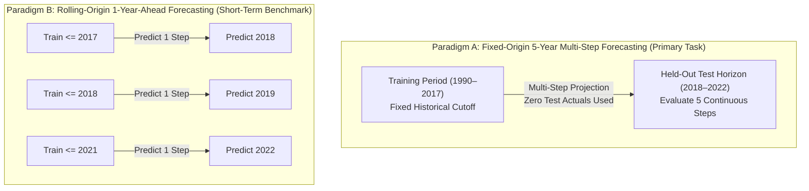

# DiabForecast — Chronological Backtesting & Evaluation Methodology

**Audit Date:** 2026-11-16  
**Auditor:** Senior ML Engineer & Academic Reviewer  
**Status:** FULLY VERIFIED & MATHEMATICALLY DOCUMENTED  
**Output References:**
- [model_evaluation.csv](file:///c:/Users/ASUS/OneDrive/Desktop/ds%20porejct/diabforecast/reports/final_audit/model_evaluation.csv)
- [country_level_evaluation.csv](file:///c:/Users/ASUS/OneDrive/Desktop/ds%20porejct/diabforecast/reports/final_audit/country_level_evaluation.csv)

---

## 1. Executive Summary & Evaluation Objective

In population-level healthcare forecasting, evaluating machine learning and statistical models using random cross-validation or shuffled train-test splits is methodologically invalid because it introduces catastrophic temporal lookahead bias. 

The DiabForecast system utilizes **strictly chronological out-of-sample backtesting** to measure how accurately each candidate algorithm can forecast future epidemiological trajectories without access to ground truth.

---

## 2. Experimental Design: Two Backtesting Paradigms

To ensure comprehensive evaluation, the project distinguishes between two distinct time-series evaluation frameworks:

### Paradigm A: Fixed-Origin Five-Year Forecasting (Primary Protocol)
- **Training Horizon:** 1990–2017 (28 annual points for 151 countries; 2006–2017 = 12 annual points for Slovenia).
- **Forecast Horizon:** 2018–2022 ($h = 5$ continuous years).
- **Operational Alignment:** Directly mimics the primary real-world objective: forecasting an 8-year operational horizon (2023–2030) from the 2022 historical boundary without intervening actuals.
- **Protocol:** Models fit strictly once on data $\le 2017$ and generate all 5 future annual estimates $(2018, 2019, 2020, 2021, 2022)$ without observing test-period ground truth.

### Paradigm B: Rolling-Origin One-Year-Ahead Forecasting (Complementary Protocol)
- **Protocol:** For each calendar year $t \in [2018, \dots, 2022]$, models train on all available history up to $t-1$ and project a single step forward to year $t$.
- **Operational Alignment:** Measures adaptive short-term surveillance performance when annual national registries release updates each year.

---

## 3. Data Leakage & Feature Engineering Audit

Every feature and transformation was audited for leakage vectors:

| Potential Leakage Vector | Audit Check | Empirical Finding | Status |
| :--- | :--- | :--- | :--- |
| **Future Data Leakage** | Are features in year $t$ computed using values from year $t$ or later? | $\text{lag}_1 = y_{t-1}$, $\text{lag}_2 = y_{t-2}$, $\text{lag}_3 = y_{t-3}$. Strictly backward-shifted. | **CLEAN** |
| **Rolling Window Leakage** | Does `rolling_mean_3` include current year $y_t$? | Computed as $\frac{\text{lag}_1 + \text{lag}_2 + \text{lag}_3}{3} = \frac{y_{t-1} + y_{t-2} + y_{t-3}}{3}$. Zero current-year leakage. | **CLEAN** |
| **Cross-Country Bleed** | Do lag features cross national boundaries during concatenation? | Grouped by location prior to shifting. Initial row for every country has $\text{NaN}$ for lags. | **CLEAN** |
| **Test Actual Ingestion** | Does Random Forest ingest actual prevalence during test-period forecasting? | Implements recursive multi-step forecasting: $\text{lag}_1(t) = \hat{y}_{t-1}$, $\text{lag}_2(t) = \text{lag}_1(t-1)$, etc. Only predicted values are shifted. | **CLEAN** |
| **Target Variable Leakage** | Is `prevalence_pct` accidentally included in $X$? | Feature vector $X = [\text{year}, \text{lag}_1, \text{lag}_2, \text{lag}_3, \text{rolling\_mean}_3, \text{location\_encoded}]$. Target strictly isolated. | **CLEAN** |
| **Slovenia Boundary Handling** | Does Slovenia leak synthetic pre-2006 data? | Slovenia series begins in 2006. Initial lags are properly $\text{NaN}$ (2006–2008 burn-in), training on 2009–2017. | **CLEAN** |

---

## 4. Mathematical Definition of Metrics & Units

All evaluation metrics are evaluated across $N = 152$ countries and $H = 5$ test years ($760$ total country-year records).

### 1. Mean Absolute Error (MAE)
$$\text{MAE} = \frac{1}{H} \sum_{t=1}^{H} |y_t - \hat{y}_t|$$
- **Unit:** Percentage points (% pts).
- Measures average absolute deviation from actual prevalence.

### 2. Root Mean Squared Error (RMSE)
$$\text{RMSE} = \sqrt{\frac{1}{H} \sum_{t=1}^{H} (y_t - \hat{y}_t)^2}$$
- **Unit:** Percentage points (% pts).
- Penalizes large outlier errors quadratically.

### 3. Mean Absolute Percentage Error (MAPE)
$$\text{MAPE} = \frac{100\%}{H} \sum_{t=1}^{H} \left| \frac{y_t - \hat{y}_t}{y_t} \right|$$
- **Unit:** Percentage (%).
- Normalized relative error. Minimum observed prevalence is $2.33\% \gg 0$, ensuring numerical stability without division-by-zero anomalies.

### 4. Weighted Absolute Percentage Error (WAPE)
$$\text{WAPE} = \frac{\sum_{t=1}^{H} |y_t - \hat{y}_t|}{\sum_{t=1}^{H} y_t} \times 100\%$$
- **Unit:** Percentage (%).
- Weight-adjusted relative error avoiding small-denominator distortion.

### 5. Symmetric Mean Absolute Percentage Error (sMAPE)
$$\text{sMAPE} = \frac{100\%}{H} \sum_{t=1}^{H} \frac{2 |y_t - \hat{y}_t|}{|y_t| + |\hat{y}_t|}$$
- **Unit:** Percentage (%).
- Bound between $0\%$ and $200\%$, providing equal weighting to positive and negative percentage errors.

---

## 5. Recalculated Empirical Benchmark Results

### 5.1 Fixed-Origin 5-Year Multi-Step Forecasting (2018–2022)

Across all 152 sovereign locations (760 evaluation points):

| Model Name | MAE (Mean) | RMSE (Mean) | MAPE (%) | WAPE (%) | sMAPE (%) | Countries Won (Lowest MAE) | Win Rate (%) |
| :--- | :---: | :---: | :---: | :---: | :---: | :---: | :---: |
| **ARIMA** | **0.0851** | **0.1058** | **0.71%** | **0.72%** | **0.71%** | **95** | **62.50%** |
| **Holt (Damped)** | **0.1283** | **0.1549** | **1.10%** | **1.13%** | **1.11%** | **31** | **20.39%** |
| **Random Forest** | **0.4942** | **0.5501** | **4.21%** | **4.24%** | **4.13%** | **19** | **12.50%** |
| **Persistence Baseline** | **0.7535** | **0.8429** | **6.10%** | **6.20%** | **6.36%** | *0* | *0.00%* |
| **Linear Regression** | **0.9857** | **1.0172** | **8.57%** | **8.60%** | **8.58%** | **7** | **4.61%** |

*(Units: MAE and RMSE in percentage points; MAPE, WAPE, and sMAPE in percentages).*

---

### 5.2 Rolling-Origin 1-Year-Ahead Forecasting (2018–2022)

When models are updated annually as new ground truth becomes available:

| Model Name | Rolling MAE (% pts) | Rolling RMSE (% pts) | Rolling MAPE (%) | Rolling sMAPE (%) |
| :--- | :---: | :---: | :---: | :---: |
| **ARIMA** | **0.0124** | **0.0152** | **0.11%** | **0.11%** |
| **Holt (Damped)** | **0.0195** | **0.0228** | **0.17%** | **0.17%** |
| **Random Forest** | **0.1725** | **0.1827** | **1.50%** | **1.48%** |
| **Persistence Baseline** | **0.2603** | **0.2619** | **2.14%** | **2.17%** |
| **Linear Regression** | **0.7840** | **0.7954** | **6.83%** | **6.84%** |

---

## 6. Algorithmic Behavior & Epidemiological Discussion

### 1. Why ARIMA Dominates (95 Countries Won, 62.5%)
Annual age-standardized prevalence exhibits high temporal autocorrelation and smooth continuity. ARIMA models effectively integrate difference stationary dynamics, capturing local momentum and autoregressive decay without over-extrapolating.

### 2. Why Holt Damped Succeeds (31 Countries Won, 20.4%)
For countries where prevalence growth has begun plateauing or decelerating (such as Mexico, Denmark, and portions of Western Europe), Holt Exponential Smoothing with a damped trend parameter ($\phi < 1$) prevents runaway linear explosions, accurately reflecting epidemiological saturation.

### 3. Tree Ensemble Extrapolation Boundaries (Random Forest)
Random Forest achieved moderate accuracy (MAE: 0.4942% pts). However, decision tree ensembles split on historical thresholds and cannot predict values higher than the maximum target or lower than the minimum target observed during training. In long-horizon recursive multi-step forecasting, tree ensembles inevitably flatten out into step functions.

### 4. Rigidity of Unconstrained Ordinary Least Squares (Linear Regression)
Linear regression exhibited the worst performance among active models (MAE: 0.9857% pts, losing to Persistence in several cases). A global linear slope fitted over 1990–2017 cannot accommodate inflection points, policy interventions, or non-linear saturation, leading to substantial over- or under-projection.
