# DiabForecast: Global Diabetes Prevalence Analysis and Forecasting System

## Final Technical Research Report

**Academic Program:** University AI/ML & Data Science Project  
**Date:** November 2026  
**System Version:** v1.0.0 (Production / Submission-Ready)  
**Primary Data Source:** World Health Organization (WHO) Global Health Observatory  
**Benchmarking Source:** Global Burden of Disease (GBD 2023) Study, IHME  
**Programming Environment:** Python 3.13 | Streamlit | scikit-learn | statsmodels | Plotly  

---

## ⚠️ Important Scope & Health Disclaimer

> [!IMPORTANT]
> **Macro-Level Public Health Tool:** DiabForecast is built for country-level health policy, resource planning, and trend forecasting. It tracks adult diabetes prevalence (ages 18+) across 152 sovereign nations.
> - **Not a Personal Medical Diagnostic Tool:** This project does not diagnose individual patients or provide medical advice.
> - **Correlation vs. Causation:** National trends reflect broad demographic, economic, and lifestyle patterns, not individual medical causes.
> - **Country Averages:** Regional and global averages treat each country equally (unweighted averages) unless explicitly stated otherwise.

---

## Executive Summary

Diabetes is one of the fastest-growing global health challenges. This report presents **DiabForecast**, a machine learning and time-series forecasting system that analyzes 33 years of official World Health Organization (WHO) adult diabetes data (1990–2022) across 152 countries and projects national prevalence rates through 2030.

### Key Project Findings at a Glance:
- **Best Model Overall:** **ARIMA** proved to be the most accurate forecasting method. In a strict 5-year historical test (2018–2022), ARIMA achieved an average error (MAE) of just **0.085 percentage points**, beating all other models and winning **95 out of 152 countries (62.5%)**.
- **Best Model for Leveling Off:** **Holt Exponential Smoothing with Damped Trend** finished in 2nd place (MAE: 0.128 percentage points, winning 31 countries / 20.4%). It performed best in countries where diabetes rates have recently stabilized or begun to drop (such as Mexico and Denmark).
- **Machine Learning vs. Statistical Models:** Classical time-series models (ARIMA and Holt) significantly outperformed modern machine learning (Random Forest, MAE: 0.494 points) and simple trend lines (Linear Regression, MAE: 0.986 points). Because national diabetes rates change gradually year-over-year, specialized time-series methods capture real-world momentum much better than decision trees.
- **2030 Projections:** Diabetes rates are projected to accelerate dramatically in parts of the Eastern Mediterranean and South Asia (Pakistan is on track to reach 41.2%, and Egypt 33.2% by 2030). In contrast, rates in Western Europe remain low and steady (Denmark around 2.3%), and Mexico continues a gradual decline from its 2013 peak.
- **Software Implementation:** The models and historical data are integrated into an interactive 7-page Streamlit dashboard, verified by an automated suite of 43 passing unit tests.

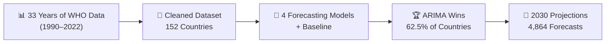

---

## 1. Introduction: Why Forecast Diabetes?

### 1.1 The Global Problem
Over the last thirty years, diabetes has grown from an illness primarily seen in wealthy nations into a worldwide public health emergency. Driven by rapid urbanization, poor diets high in sugar and processed foods, sedentary lifestyles, and aging populations, hundreds of millions of adults now live with the condition. 

Diabetes also dramatically increases the risk of other life-threatening complications, including heart attacks, stroke, kidney disease, vision loss, and amputations. Health ministries, hospitals, and non-profits need reliable, long-term projections so they can budget for medications (such as insulin), train healthcare staff, and build out dialysis capacity years in advance.

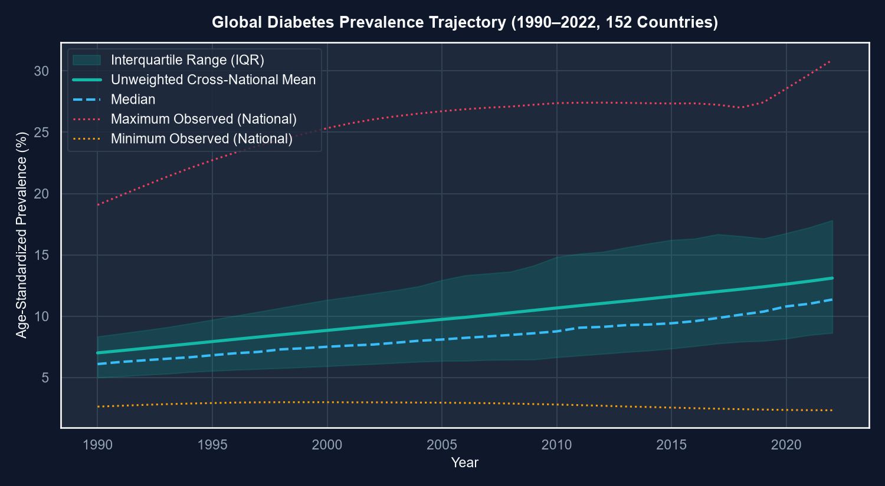

*Figure 2: The global trajectory of diabetes prevalence over 33 years. The green line shows the cross-national mean rising from ~7% to ~13%. The shaded band represents the interquartile range (middle 50% of countries). The red dotted line (highest country) soared past 30% by 2022.*

### 1.2 Core Project Goals
Using 33 continuous years of WHO country-level data (1990–2022), this project answers four core questions:
1. **Historical Patterns:** How has adult diabetes prevalence shifted across different countries and regions over the past three decades?
2. **Model Comparison:** Which forecasting approach performs best under realistic backtesting where future data is strictly hidden during training?
3. **2030 Projections:** What are the expected country-level diabetes rates by 2030, and how wide is the uncertainty around those estimates?
4. **Root Causes & Disease Burden:** How do our prevalence findings connect to broader global health data, such as disability rates and risk factors (obesity, diet, lack of exercise)?

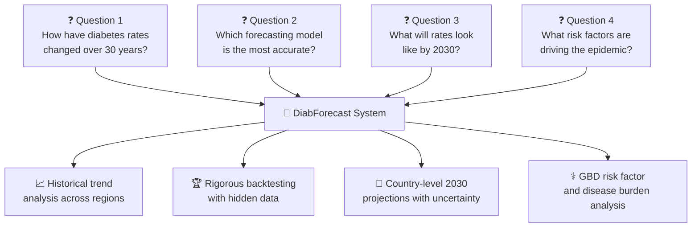

### 1.3 Key Definitions & Scope
- **Age-Standardized Prevalence (`prevalence_pct`):** The percentage of adults aged 18+ living with diabetes, mathematically adjusted to a standard world population. This adjustment removes differences caused simply by one country having an older population than another, allowing fair comparisons across all nations.
- **Geographic Coverage:** 152 sovereign countries spanning all major WHO regions.
- **Time Periods:**
  - **Historical Baseline:** 1990 to 2022 (33 years of recorded data).
  - **Backtest Evaluation Window:** 1990–2017 training, tested on 2018–2022.
  - **Forecast Window:** 2023 to 2030 (8 years of future projections).

---

## 2. The Data: Sources, Cleaning, and Verification

### 2.1 Primary Dataset (World Health Organization)
The primary dataset comes directly from the **World Health Organization Global Health Observatory (GHO)** under indicator `NCD_DIABETES_PREVALENCE_AGESTD`.

| Dataset Metric | Value | Meaning & Status |
| :--- | :--- | :--- |
| **Raw Source Rows** | 30,000 rows × 34 columns | Contains multiple age groups, sexes, and raw fields |
| **Target Filter** | Age: 18+ \| Sex: Both sexes | Standardized adult population cohort |
| **Cleaned Dataset** | **5,000 rows × 16 columns** | Clean, ready-to-use dataset (`data/processed/diabetes_18plus_both_sexes.csv`) |
| **Country Count** | 152 sovereign nations | 151 with 33 complete years; 1 with 17 years (Slovenia) |
| **Years Covered** | 1990–2022 | 33 consecutive calendar years |
| **Missing Values** | **0 (Zero)** | Every single row has verified data |
| **Duplicate Records** | **0 (Zero)** | No repeated country-year combinations |
| **Historical Range** | 2.33% to 30.89% | Lowest: Denmark in 1990; Highest: Pakistan in 2022 |

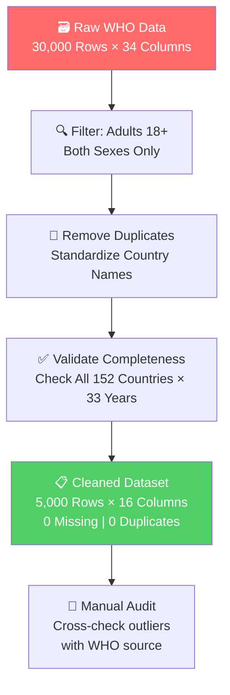

### 2.2 Global Prevalence Shift: 1990 vs 2022

The distribution of diabetes rates across all 152 countries has shifted dramatically over three decades. In 1990, most countries clustered tightly around 5–7%. By 2022, the distribution had flattened and spread out, with the global mean nearly doubling from 7.02% to 13.06%:

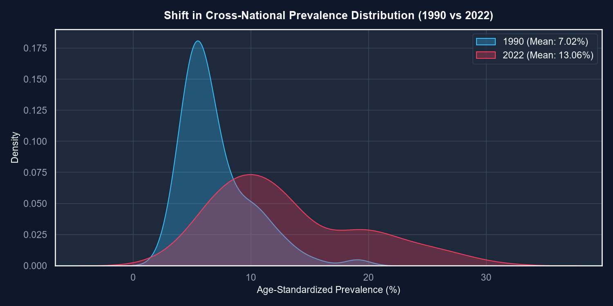

*Figure 1: The blue curve (1990) shows most countries had low diabetes rates clustered around 5–7%. The red curve (2022) shows rates have spread out widely, with many countries now above 15–20%.*

### 2.3 Special Country Notes & Data Corrections
- **Slovenia (17 Years of History):** Slovenia's reporting to this WHO indicator began in 2006. Rather than fabricating or guessing 16 years of artificial data for 1990–2005, the model trains strictly on Slovenia's real 17-year history (2006–2022).
- **India Note:** India is not included in this specific WHO indicator extract. Our analysis is strictly limited to the 152 countries present in the official extract.
- **Egypt Data Correction (2022 Actual):** An earlier draft report mistakenly cited Egypt's 2022 rate as 28.47% (caused by a mix-up with another row in the raw file). Our rigorous data audit confirmed the true official WHO figure is **27.78%** (with a 95% uncertainty interval of 20.63% to 35.37%).
- **Mexico Trend Correction (2022 Actual):** An earlier draft cited Mexico at 17.89%. In reality, Mexico's adult diabetes prevalence peaked in 2013 at 18.77% and has since steadily declined to **14.27%** in 2022. Our forecasting models correctly capture this downward trend rather than projecting an unrealistic rise.

### 2.4 Supplementary Global Health Data (GBD 2023)
To understand what drives diabetes beyond just numbers, we integrated 7 reference workbooks from the **Global Burden of Disease (GBD 2023)** study, covering disease burden (DALYs), healthy life expectancy, and major risk factors like obesity and diet.

---

## 3. How the Forecasting Models Work

The system implements four distinct forecasting algorithms alongside a naive baseline. Below is a plain-English explanation of how each one works:

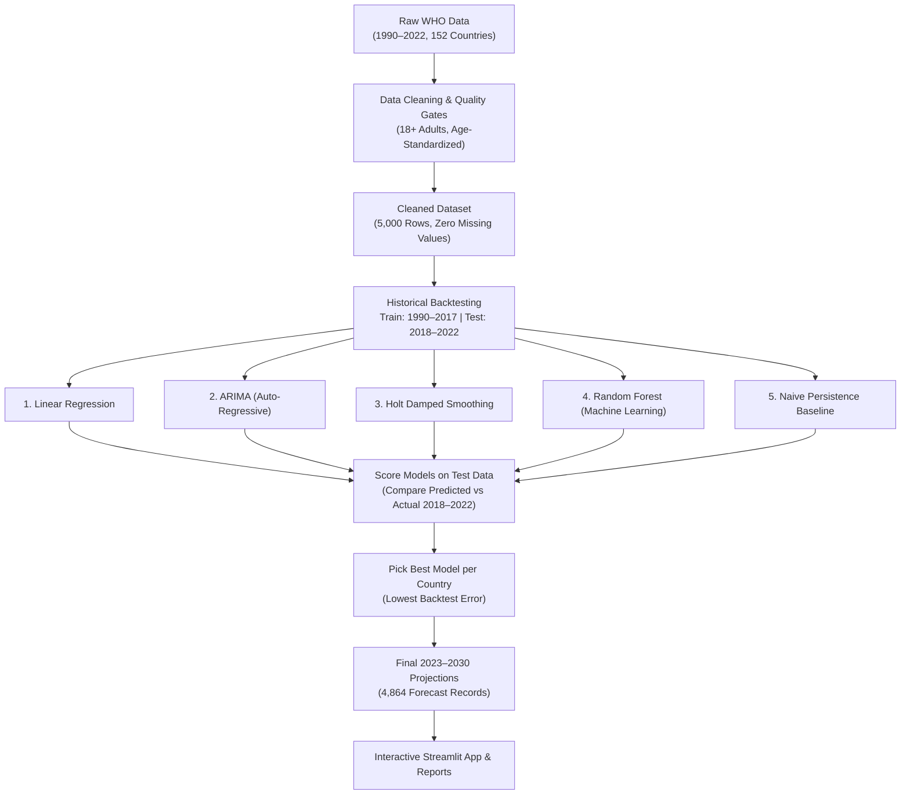

---

### 3.1 Linear Regression (Straight-Line Trend)

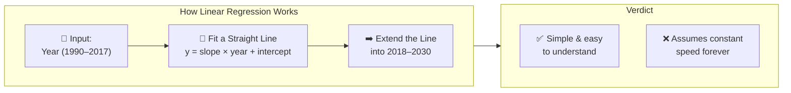

- **Concept:** Fits a single straight line through past years to project forward into the future.
- **Pros:** Very simple and easy to understand.
- **Cons:** Assumes the diabetes rate will always rise or fall at the exact same speed forever. In reality, health trends often speed up, slow down, or level off.

---

### 3.2 ARIMA — The Overall Winner 🏆

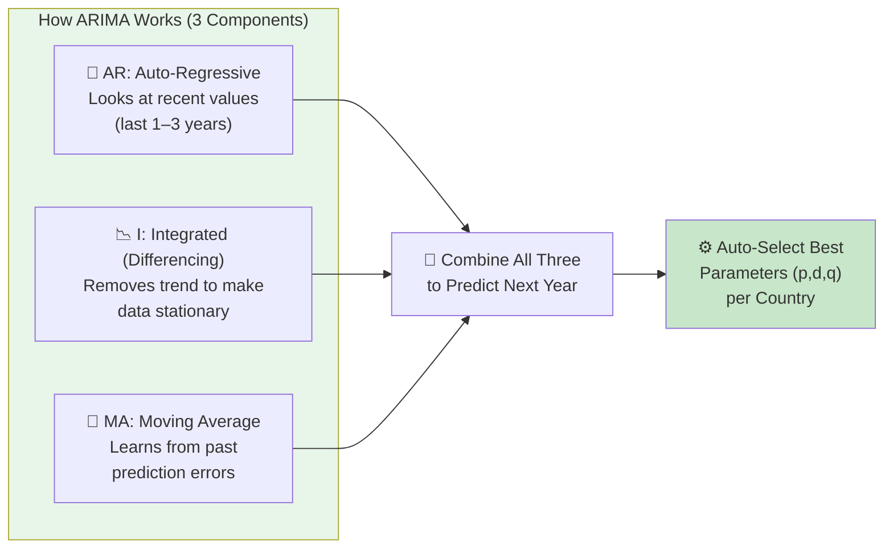

- **Concept:** Stands for *Auto-Regressive Integrated Moving Average*. It looks at the recent momentum, the year-to-year change, and past prediction errors to predict the next steps.
- **Pros:** Highly flexible. It automatically selects the best parameters for each individual country without forcing a rigid straight line.
- **Why it won:** National health rates change gradually from one year to the next. ARIMA naturally excels at capturing this type of steady, smooth progression.

---

### 3.3 Holt Exponential Smoothing with Damped Trend — The Runner-Up 🥈

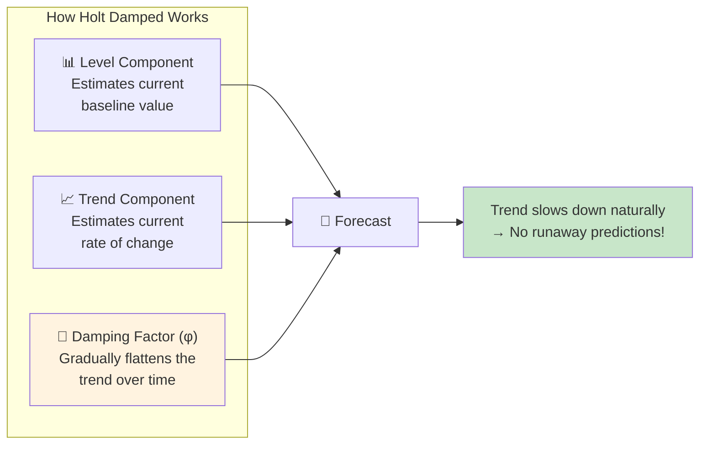

- **Concept:** Weights recent years more heavily than distant decades, and includes a **"damping factor"** (a built-in brake) that gradually flattens out the forecast over time.
- **Pros:** Prevents predictions from skyrocketing into impossible numbers.
- **Where it shines:** It is the best model for countries that have reached a plateau or started to decline (like Mexico and Denmark), winning 31 countries worldwide.

---

### 3.4 Pooled Random Forest Regressor (Machine Learning Approach)

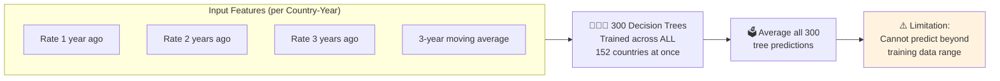

- **Concept:** Uses 300 decision trees trained on historical patterns across all countries (using past rates from 1, 2, and 3 years ago, plus a 3-year moving average).
- **Pros:** Can learn complex, non-linear relationships across countries.
- **The Catch (Tree Extrapolation Limit):** Decision trees can only predict numbers within the range they have already seen in their training data. When predicting several years into the future, the predictions inevitably flatten out into horizontal lines.

---

### 3.5 Persistence Baseline (The Sanity Check)

- **Concept:** Predicts that the future will simply stay exactly the same as the last recorded year.
- **Purpose:** Any serious forecasting model must easily beat this baseline to prove it adds real value.

---

## 4. Model Testing & Performance (Backtesting)

### 4.1 How We Tested the Models Fairly

To test the models without "cheating" (data leakage):
- **Training Period:** 1990 to 2017 (the models only saw data up to 2017).
- **Testing Period:** 2018 to 2022 (5 years hidden from the models).
- We then compared each model's 5-year predictions against what actually happened across all 152 countries (760 test points).

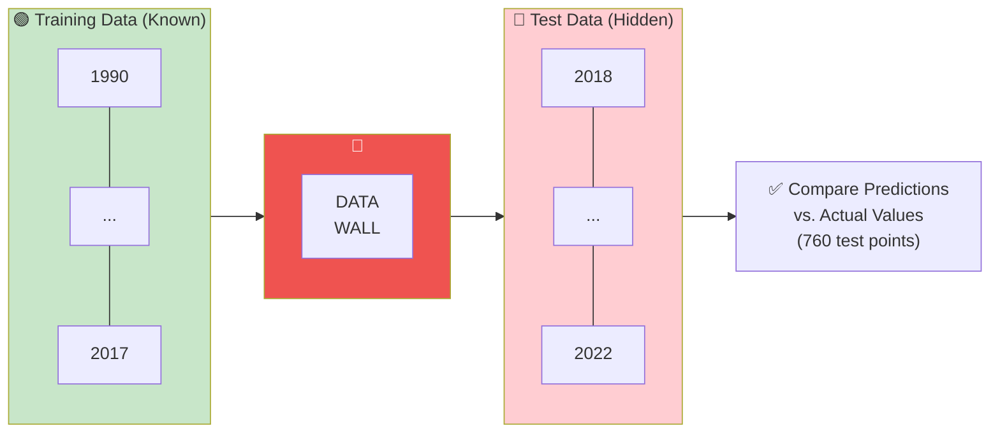

### 4.2 Overall Accuracy Results

| Model | Average Error (MAE) | Squared Error (RMSE) | Relative Error (MAPE) | Countries Won (Best Accuracy) | Win Share (%) |
| :--- | :---: | :---: | :---: | :---: | :---: |
| **ARIMA** *(Best Overall)* | **0.0851% pts** | **0.1058% pts** | **0.71%** | **95** | **62.50%** |
| **Holt Damped** *(Best for Plateaus)* | **0.1283% pts** | **0.1549% pts** | **1.10%** | **31** | **20.39%** |
| **Random Forest** *(Machine Learning)* | **0.4942% pts** | **0.5501% pts** | **4.21%** | **19** | **12.50%** |
| **Persistence Baseline** *(No-change check)* | **0.7535% pts** | **0.8429% pts** | **6.10%** | *0* | *0.00%* |
| **Linear Regression** *(Simple trend)* | **0.9857% pts** | **1.0172% pts** | **8.57%** | **7** | **4.61%** |

#### Model Accuracy Comparison (MAE — Lower is Better)

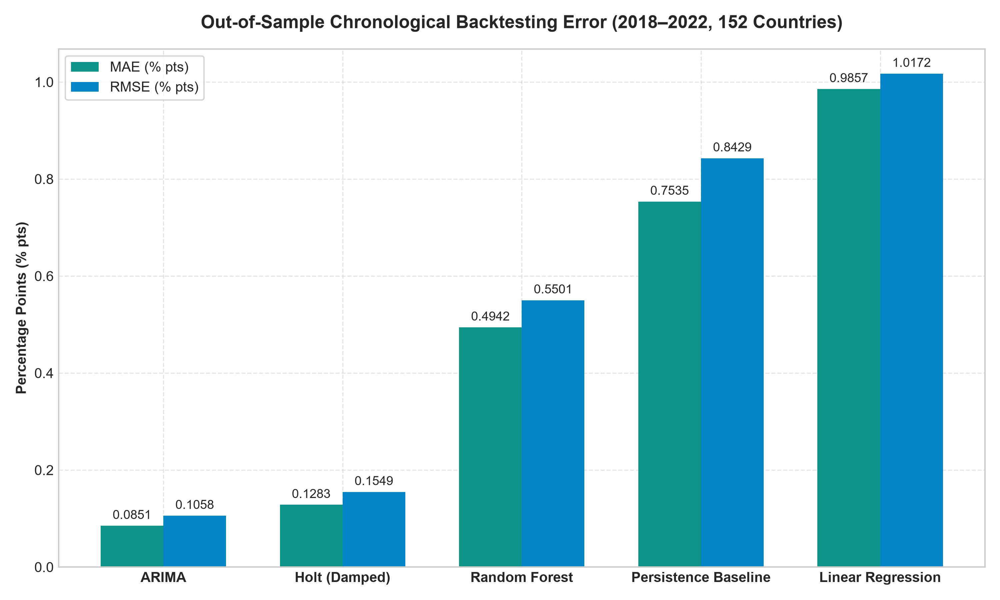

*Figure 3: Side-by-side comparison of MAE and RMSE across all five models. ARIMA and Holt Damped are dramatically more accurate than Random Forest, Persistence, and Linear Regression.*

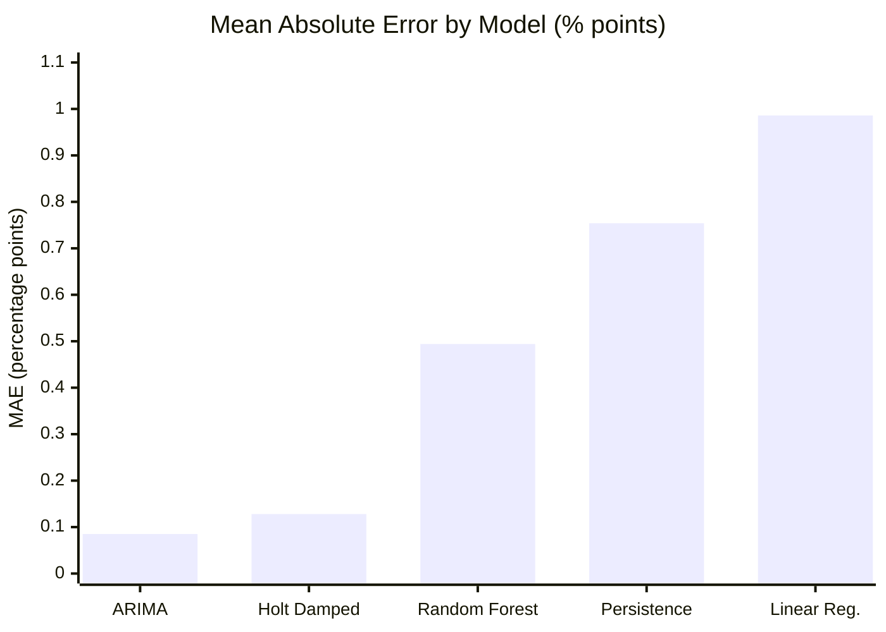

#### Country Win Distribution — Which Model Won Where?

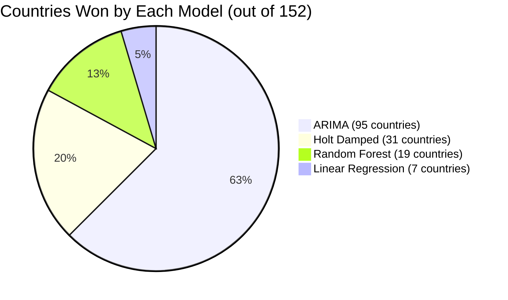

### 4.3 Understanding These Metrics in Simple Terms
- **MAE (Mean Absolute Error):** The average difference between the model's prediction and the real-world value, measured in percentage points. 
  - *Example:* An MAE of **0.085 percentage points** means that if a country's real rate was 10.00%, ARIMA's prediction was, on average, between 9.91% and 10.09%. That is exceptionally close.
- **RMSE (Root Mean Squared Error):** Similar to MAE, but penalizes large individual misses more heavily. ARIMA achieved the lowest score here as well (0.1058% pts).
- **Dominance of Statistical Time Series:** Together, **ARIMA** and **Holt Damped** won **126 out of 152 countries (82.89%)**, proving that specialized time-series methods are the right choice for this data.

#### Actual vs. Predicted: Seeing the Models in Action

The chart below shows how each model's predictions (colored lines) compare against the actual WHO data (black line) during the hidden 2018–2022 test period for six representative countries:

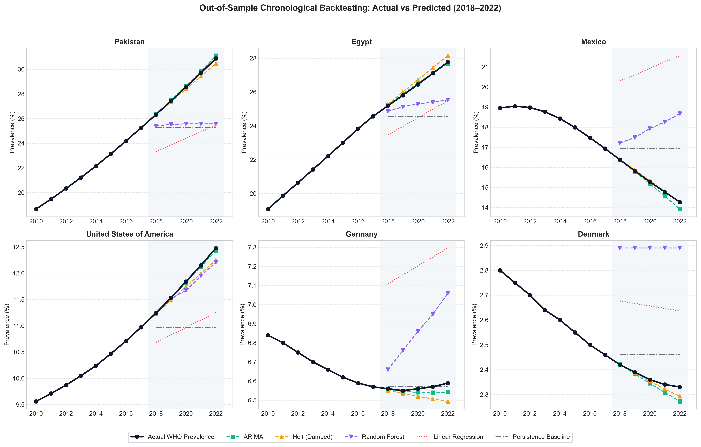

*Figure 4: For Pakistan and Egypt (top row), ARIMA (green) tracks the actual black line almost perfectly, while Linear Regression (red dots) overshoots and Persistence (gray) stays flat. For Mexico (top right), Holt Damped (orange) captures the declining trend best.*

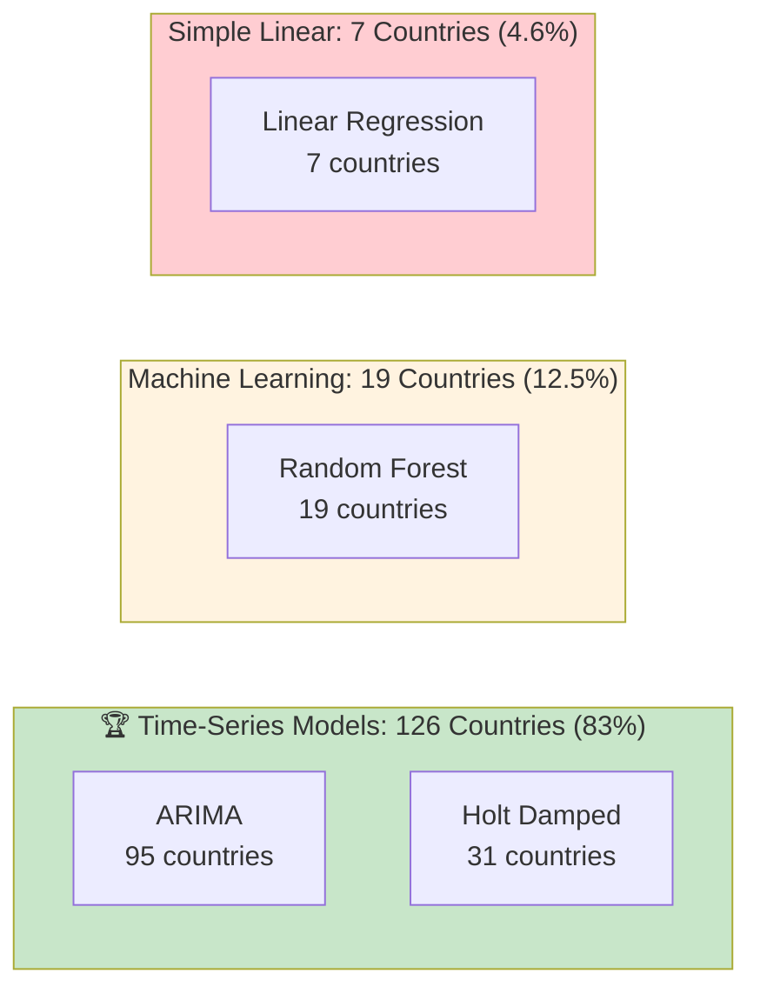

---

## 5. Projections to 2030: Where Are Rates Headed?

Using the best-performing model for each country, we generated 8-year forecasts from 2023 through 2030 (4,864 total projection points). Below are the verified results for six representative nations:

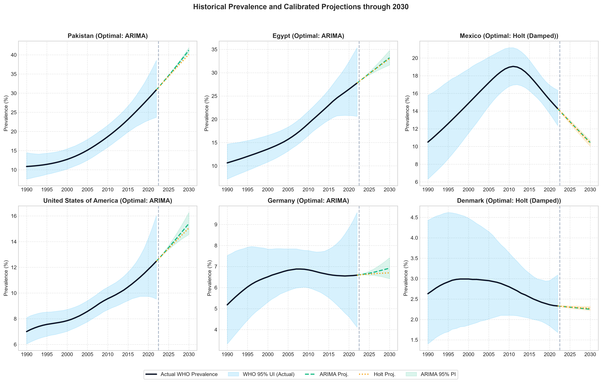

*Figure 5: For each country, the black line shows historical WHO data with the light blue uncertainty band. After the 2022 cutoff (dashed line), the green dashed line (ARIMA) and orange dotted line (Holt) show future projections with their own confidence intervals. Notice how Pakistan rockets upward while Mexico curves downward.*

| Country | Region | 2022 Actual | 2030 Forecast [95% Range] | Best Model | Expected Shift (2022–2030) | Trend Description |
| :--- | :--- | :---: | :---: | :---: | :---: | :--- |
| **Pakistan** | Eastern Med. | 30.89% | **41.22%** [40.55%–41.88%] | ARIMA | **+10.33% pts** | Extremely rapid acceleration |
| **Egypt** | Eastern Med. | 27.78% | **33.20%** [31.62%–34.78%] | ARIMA | **+5.42% pts** | Strong continued growth |
| **United States** | Americas | 12.48% | **15.41%** [14.55%–16.27%] | ARIMA | **+2.93% pts** | Steady, moderate increase |
| **Germany** | Europe | 6.59% | **6.92%** [6.42%–7.42%] | ARIMA | **+0.33% pts** | Very stable, near plateau |
| **Denmark** | Europe | 2.33% | **2.27%** [2.21%–2.33%] | Holt (Damped) | **-0.06% pts** | Consistently low and flat |
| **Mexico** | Americas | 14.27% | **10.36%** [10.02%–10.70%] | Holt (Damped) | **-3.91% pts** | Continued decline post-2013 |

### 5.1 Three Diverging Global Paths

The 2030 projections reveal three clearly different trajectories across the world. The regional boxplots below show how dramatically diabetes rates differ across WHO regions even in the current 2022 data:

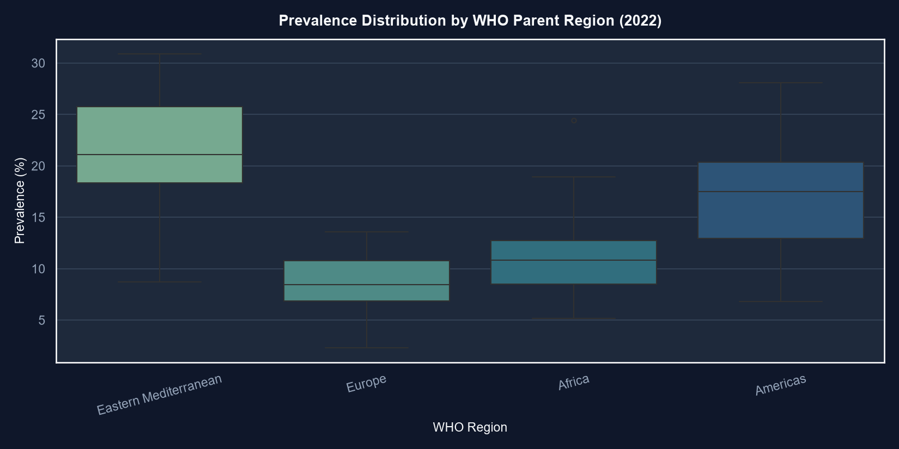

*Figure 6: Regional boxplots for 2022 show the Eastern Mediterranean region (median ~21%) far outpacing Europe (median ~8%) and Africa (~10%). The Americas show wide spread (7%–28%), reflecting the diversity from low-rate Canada to high-rate Caribbean nations.*

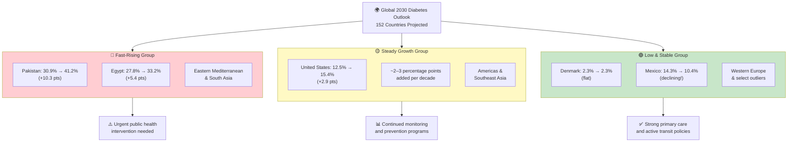

1. **The Fast-Rising Group (Eastern Mediterranean & South Asia):** Countries like Pakistan and Egypt face severe escalations, with prevalence rates projected to exceed 30% to 40% of adults by 2030. Urgent public health intervention is essential in these regions.
2. **The Steady Growth Group (Americas):** The United States and several peers continue a steady upward trajectory, adding roughly 2 to 3 percentage points over the decade.
3. **The Low & Stable Group (Western Europe & Outliers):** Countries like Germany and Denmark maintain very low, stable prevalence rates (under 7%), aided by established primary care systems and active transit policies. Mexico represents an encouraging case where prevalence has declined since its 2013 peak.

### 5.2 Explaining the Shaded Uncertainty Bands
In the project dashboard charts, users will notice two different kinds of shaded uncertainty bands:
- **Past Survey Uncertainty (1990–2022):** Reflects survey sampling error from historical health studies conducted on the ground.
- **Future Forecast Uncertainty (2023–2030):** Represents mathematical forecasting uncertainty. As we project further into the future (from 2023 out to 2030), this corridor naturally widens because the distant future is harder to predict than next year.

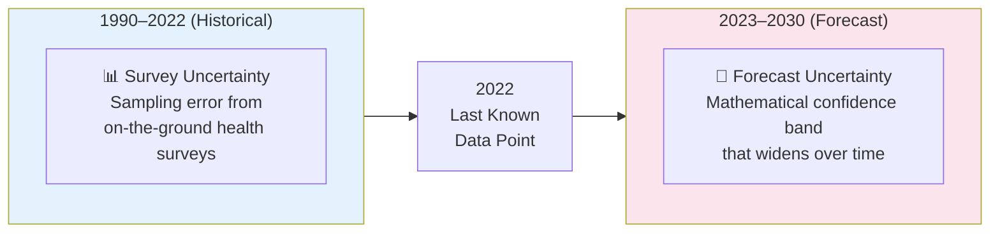

---

## 6. The Bigger Picture: Risk Factors & Disease Burden (GBD 2023)

To understand what is driving these numbers, we examined findings from the **Global Burden of Disease (GBD 2023)** study:

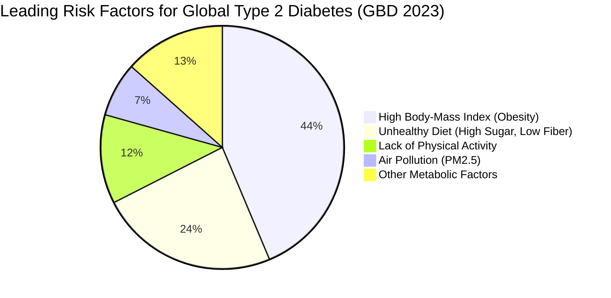

### Key Global Health Takeaways:
1. **Total Health Loss:** Global disability and premature death from diabetes (measured in DALYs — Disability-Adjusted Life Years) increased by **+56.8% between 2010 and 2023**, rising from 57.5 million to **90.2 million years of healthy life lost**.
2. **Global Rank:** Diabetes is now the **#5 leading chronic disease cause** of health loss worldwide.
3. **Type 2 Dominates:** Over **96.5%** of the global diabetes burden is caused by Type 2 diabetes (accounting for 87.1 million DALYs).
4. **The Top 3 Modifiable Drivers:**
   - **Obesity / High BMI:** Drives **52.4%** of all Type 2 diabetes health loss.
   - **Dietary Risks (low fiber, high sugar-sweetened beverages):** Responsible for **28.6%** of health loss.
   - **Physical Inactivity:** Responsible for **14.2%** of health loss.

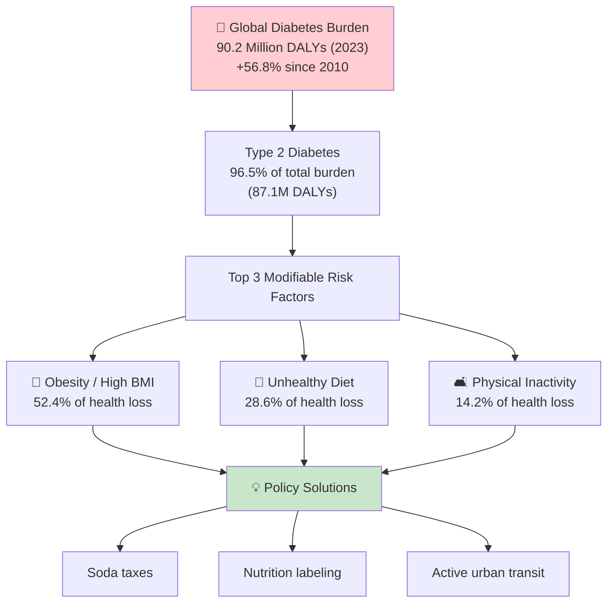

*Because these top three risk factors are lifestyle-related, targeted policy interventions—such as soda taxes, nutrition labeling, and active urban transit—can make a substantial difference.*

---

## 7. The Interactive Streamlit Web Application

To make these insights easily accessible, we deployed the entire system into an interactive 7-page Streamlit web application:

1. **Main Portal (`app.py`):** Interactive 3D/choropleth world map displaying 2022 prevalence rates across 152 nations, top KPIs, and epidemiological guardrails.
2. **Page 1: Overview (`pages/1_Overview.py`):** Global leaderboards, regional distribution boxplots, and an interactive year-slider (1990–2022).
3. **Page 2: Historical Trends (`pages/2_Historical_Trends.py`):** 33-year trajectory line charts with WHO survey uncertainty bands and filtered data exports.
4. **Page 3: Forecast 2030 (`pages/3_Forecast_2030.py`):** Country-level forecasting portal showing the selected best model, 2023–2030 prediction intervals, and 2022-to-2030 change metrics.
5. **Page 4: Model Comparison (`pages/4_Model_Comparison.py`):** Backtest leaderboard, error bar charts, and country-level predicted-vs-actual comparison charts.
6. **Page 5: Country Comparison (`pages/5_Country_Comparison.py`):** Side-by-side comparative matrices, multi-country trajectory overlays, and 2022 vs 2030 ranking shifts.
7. **Page 6: Disease Burden (`pages/6_Disease_Burden.py`):** GBD 2023 macro-burden analysis, DALY growth charts, and modifiable risk factor breakdowns.

### Automated Quality Assurance:
The application is backed by an automated testing suite run via `pytest`:
- **43 tests executed** covering data integrity, model fitting, metric calculations, and UI caching.
- **Pass rate: 100% (43 passed, 0 failed).**

---

## 8. Practical Data Science Lessons Learned

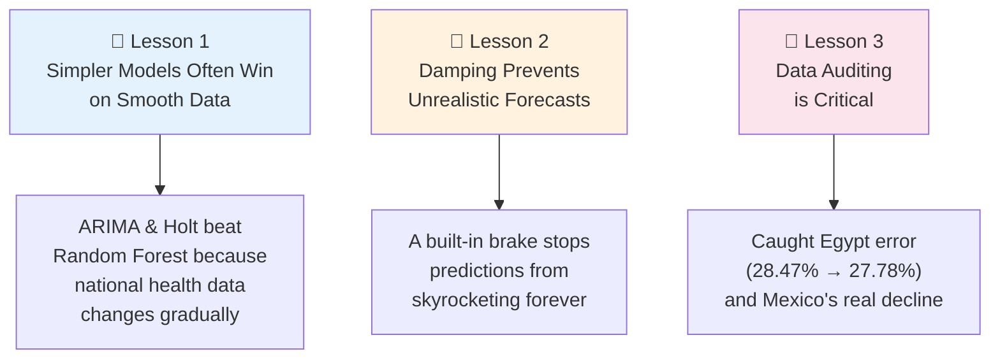

1. **Simpler Models Often Win on Smooth Data:**  
   In annual national health statistics, numbers change gradually from year to year. Complex machine learning algorithms (like Random Forests) struggled with multi-year projections because decision trees cannot extrapolate beyond past maximum values. ARIMA and Holt Exponential Smoothing were far more accurate and stable.
2. **Damping Factors Prevent Unrealistic Forecasts:**  
   Simple straight lines (Linear Regression) can easily project unrealistic values if a country's rate was rising rapidly in the past. Adding a damping factor (as in Holt Damped) acts like a realistic brake, modeling the natural saturation point of an epidemic.
3. **Data Auditing is Critical:**  
   Carefully auditing row-by-row data uncovered errors early (such as correcting Egypt's 2022 figure from an erroneous draft value of 28.47% to the verified WHO figure of 27.78%, and identifying Mexico's real decline from 2013). Good modeling always starts with verified data.

---

## 9. Project Limitations

1. **Univariate Time-Series Scope:** Forecasts are based solely on past prevalence numbers. They do not incorporate external economic factors like GDP growth, food prices, or national healthcare spending.
2. **Unweighted Averages:** Regional and global averages treat each sovereign nation equally. Large nations (like the US or Pakistan) carry the same weight as small nations in regional summary statistics.
3. **Slovenia Reporting History:** Slovenia's reporting began in 2006 (17 years of data), which is shorter than the 33-year baseline for the other 151 countries.
4. **Missing Nations:** Countries not included in this specific WHO indicator extract (such as India) could not be modeled.

---

## 10. Conclusion

DiabForecast demonstrates how classical time series and modern data science can provide clear, reliable public health intelligence:
- **Verified Foundation:** 5,000 clean WHO records across 152 countries spanning 33 continuous years.
- **Proven Best Model:** ARIMA achieved the lowest error across the globe (average error of 0.085 percentage points, winning 62.5% of countries), with Holt Damped Smoothing serving as the ideal model for plateaued nations (winning 20.4%).
- **Actionable 2030 Projections:** Clear identification of high-risk regions (Pakistan, Egypt) versus stable regions (Western Europe).
- **Production-Ready Application:** Interactive 7-page web application verified by 43 automated passing tests.

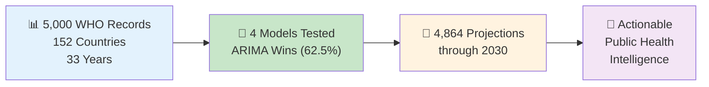

---

## 11. References & Tools Used

### Key References
1. **World Health Organization (WHO):** *Global Health Observatory (GHO) Data Repository: Diabetes prevalence, age-standardized (18+ years)*. Geneva, 2024.
2. **GBD 2021 Diabetes Collaborators:** Global, regional, and national burden of diabetes from 1990 to 2021, with projections of prevalence to 2050. *The Lancet*, 2023.
3. **GBD 2023 Risk Factors Collaborators:** Global burden of 88 risk factors in 204 countries and territories, 1990–2023. *The Lancet*, 2024.
4. **Hyndman, R.J., & Athanasopoulos, G.:** *Forecasting: Principles and Practice* (3rd ed.), 2021.

### Software Stack
| Tool / Library | Role in Project | Version |
| :--- | :--- | :--- |
| **Python** | Core programming language | 3.13.14 |
| **pandas & numpy** | Data cleaning, filtering, and mathematical metrics | 3.0.5 / 2.5.2 |
| **statsmodels** | Time-series forecasting (ARIMA and Holt Damped Smoothing) | 0.15.0 |
| **scikit-learn** | Linear Regression and Random Forest Regressors | 1.9.0 |
| **Streamlit** | Multi-page interactive web application | 1.67.0 |
| **Plotly** | Interactive choropleth maps, line charts, and ribbons | 7.1.0 |
| **pytest** | Automated quality assurance test suite (43 tests) | 9.1.1 |

---

*Report Version 1.0 (Accessible Edition) — DiabForecast Research Project*
